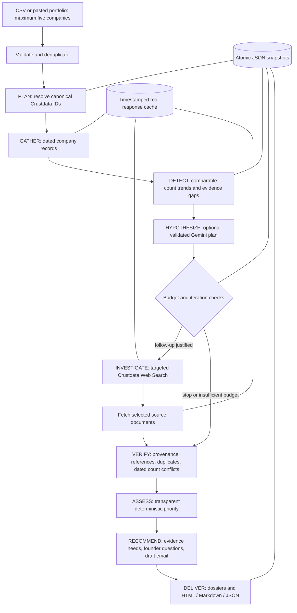

# Architecture

One bounded investigator coordinates specialized Python research functions. The LLM is an optional planner; deterministic code owns budgets, API execution, verification, scoring and persistence.

## Trust boundaries

- API credentials stay in local environment configuration and server-side HTTP headers.
- Company records are bound to canonical company IDs before enrichment is accepted.
- Provider text is untrusted data. It is never executed. The LLM can select only predefined focus categories, not arbitrary endpoints, shell commands, or recipients.
- Search results are leads, not verified developments. Fetched source content retains attribution and limitations. Error documents are excluded from article observations.
- Plans and hypotheses require valid dossier evidence IDs. LLM output does not mutate the factual ledger or numerical scores.
- Independent corroboration requires provenance beyond matching headlines or different URLs. No automatic corroboration is claimed in this MVP.
- Reports validate references again and escape HTML. External links require HTTP(S) URLs without embedded credentials.

## Termination and recovery

Global API attempt and estimated credit ceilings apply to each run. The follow-up loop has a hard maximum of four iterations/company, plus three maximum attempts/request, endpoint spacing and HTTP timeouts. Exhausted credits or invalid authentication stop further uncached calls. Individual errors create partial dossiers and preserve completed observations. Every stage saves an atomic snapshot; interrupted runs can be opened and re-investigated using cache, but there is no background resume daemon.

## Deliberate hackathon tradeoffs

JSON persistence and a single local process avoid infrastructure overhead. Workforce and hiring count histories support deterministic scoring. Leadership histories and adverse article claims require deeper structured verification before numeric scoring. The optional LLM adds hypotheses and research focus, while the entire workflow remains functional without it. Production needs access control, licensed-data retention policy, cross-session rate/budget enforcement, semantic source verification, and independently evaluated prioritization thresholds.
