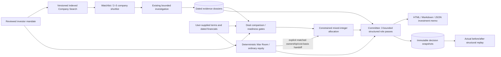
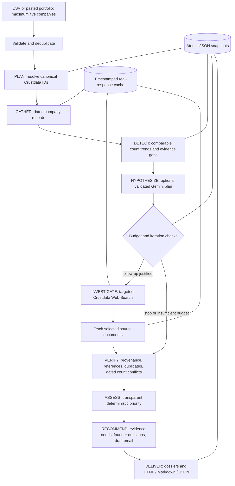

# Architecture

## VCOS decision layer

The original investigator below remains the single bounded research orchestrator. New deterministic modules consume dossiers; they never ask the LLM to calculate financial outputs or mutate external evidence.

| Module | Responsibility and trust boundary |
|---|---|
| `mandate.py` | Finite validated inputs, cross-field capital constraints, conservative thesis extraction, atomic local mandate/watchlist/snapshot persistence. No automatic hard-constraint relaxation. |
| `discovery.py` | Documented filter-only company search, fixed stable sort, cursor pagination, up to 20 results/call, no automatic enrichment. Returnable taxonomy differs from the industry filter alias. |
| `finance.py` | Supplied financial ratios, ordinary-equity entry terms, readiness, monthly cash simulation and a single round/pool/pro-rata calculation. Unsupported instruments withhold equity math. |
| `portfolio.py` | SciPy mixed-integer optimization, normalized capital variables and binary active cheques. Enforces minimum/maximum cheque, company/sector/stage exposure, reserves and liquidity; aggregates existing duplicate exposures. Includes cash as the zero-deployment alternative. Five-candidate and five-second solver limits. |
| `committee.py` | Three roles using one Gemini provider, validated evidence/assumption IDs, deterministic fallback, fixed readiness summary and structural snapshot diff. AI perspectives are hypotheses, not independent verification. |
| `vcos_reports.py` | Readable escaped HTML decision memo plus Markdown/JSON with source records, supplied inputs, financial calculations, scenario assumptions and explicit limitations. Validates committee references again. |
| `vcos_ui.py` | Seven-section Streamlit workspace, guided inputs plus full editable schemas, persistent mandate/deal context, stale allocation/committee invalidation, frozen-evidence replay. No expensive API call runs without an explicit action. |

All private artifacts stay below ignored `data/`. Currency conversion, liquidation preferences, SAFE/note conversion and return probabilities are not inferred. Empty financials remain `None`. Readiness does not imply financial health, absence of fraud or investment approval. Human document verification is explicitly a user attestation.

### Scenario conventions

Monthly burn means current **net burn**, so supplied revenue is not subtracted twice. Modeled revenue changes adjust that baseline and pass fully through to cash flow. Implementation cost occurs at month zero, burn reduction from month one, financing at the start of its specified month if the company has survived. Exhaustion at month end is absorbing; no rescue after exhaustion is assumed. Exit proceeds are zero in this capital-loss convention. Otherwise proceeds = modeled ending ownership × supplied exit value; MOIC divides by user cost basis and annualized return is `MOIC ** (1 / years) - 1`.

Portfolio optimization uses supplied MOIC scenarios, never historical startup return series or invented correlations. Cash surplus is zero in nominal terms. Moderate defaults to maximizing minimum surplus across downside/base/upside; Conservative chooses downside; Aggressive chooses base. There are no scenario probabilities. Existing holdings affect exposure and available capital, but current outcome stress testing covers new allocations only.

### Execution and freshness

Provider failures still mark research execution partial/failed. An all-failed run is failed; a mixed useful/failed run is partial. Optional Gemini failure is independent and does not convert completed collection to partial. Coverage remains the observed-category measurement; verification remains a qualitative provenance label, not a calibrated confidence probability. The shared httpx generation path prefers live-verified `gemini-3.5-flash`, validates configured overrides, and limits each pass to two generation attempts (one transient 503 retry, or an advertised alternate after 404). Low thinking and a 2,048-token output ceiling bound latency/output. Invalid references, schemas, authentication or quota open a circuit. Factual observations are not generated by committee roles; hypotheses remain labeled and cited.

Cache reads reject future, malformed, timezone-naive and expired records and retain original retrieval dates on hits. Explicit refresh bypasses the cache and preserves prior histories. Observation, event, publication, provider update and retrieval timestamps are distinct. New dated count metrics use observation dates, with legacy event-date compatibility. Company resolution is exact-first, then secondary-name candidate discovery; only an exact domain/alias corroborates automatic selection. Manual candidates are revalidated by canonical ID and domain. Duplicate canonical IDs skip repeated enrichment.

Saved decisions contain original dossiers; reopening switches visibly to frozen evidence until the user chooses current evidence. Allocation hashes cover mandate, terms and evidence; committee hashes additionally include allocation and War Room outcomes. Changed inputs cannot silently reuse an old recommendation. War Room controls recalculate locally without API requests, preserve inputs, and require an explicit ownership/cost-basis-matched action before changing a deal's modeled MOIC. Structural replay includes indexed field paths. Export validates deterministic metrics, term/source identities and allocation constraints again before rendering.

## Preserved investigation architecture

One bounded investigator coordinates specialized Python research functions. The LLM is an optional planner; deterministic code owns budgets, API execution, verification, scoring and persistence.

## Trust boundaries

- API credentials stay in local environment configuration and server-side HTTP headers.
- Company records are bound to canonical company IDs before enrichment is accepted.
- Provider text is untrusted data. It is never executed. The LLM can select only predefined focus categories, not arbitrary endpoints, shell commands, or recipients.
- Search results are leads, not verified developments. Fetched source content retains attribution and limitations. Error documents are excluded from article observations.
- Plans and hypotheses require valid dossier evidence IDs. LLM output does not mutate the factual ledger or numerical scores.
- Independent corroboration requires provenance beyond matching headlines or different URLs. No automatic corroboration is claimed in this MVP.
- Reports validate references again and escape HTML. External links require HTTP(S) URLs without embedded credentials.

## Termination and recovery

Global API attempt and estimated credit ceilings apply to each run. The follow-up loop has a hard maximum of four iterations/company, plus three maximum attempts/request, endpoint spacing and HTTP timeouts. Exhausted credits or invalid authentication stop further uncached calls. Individual errors create partial dossiers and preserve completed observations. Every stage saves an atomic snapshot; interrupted runs can be opened and re-investigated using cache, but there is no background resume daemon.

## Deliberate hackathon tradeoffs

JSON persistence and a single local process avoid infrastructure overhead. Workforce and hiring count histories support deterministic scoring. Leadership histories and adverse article claims require deeper structured verification before numeric scoring. The optional LLM adds hypotheses and research focus, while the entire workflow remains functional without it. Production needs access control, licensed-data retention policy, cross-session rate/budget enforcement, semantic source verification, and independently evaluated prioritization thresholds.
